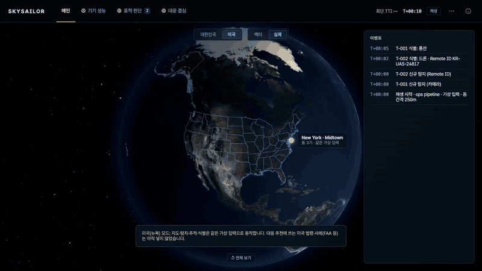
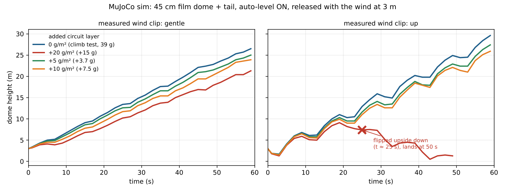

<h1 align="center">skysailor</h1>

<p align="center"><b>무동력 공중 센서 기반 C-UAS 탐지·결심지원 체계</b></p>

<p align="center">
  <a href="docs/media/c-uas-ops-demo.mp4"></a>
</p>

<p align="center"><sub>「T1 — UAS & CUAS 무인항공체계(UAS) 및 대드론(CUAS) · 비행장 방공·관제·미사일·드론 방어 AIRBASE DEFENSE · 분야 내 자율 제안」<br>

skysailor는 기존의 프로펠러 등의 동력을 활용한 드론의 형태에서 벗어나, 공기의 흐름과 흐름의 변화만을 이용하여 고도를 유지하거나, 원하는 이동을 구현하는 새로운 초저전력 비행 시스템을 구축합니다.

또한, 초저전력을 활용하여 다수의 비행체를 띄울 수 있다는 점에서 착안하여, 저공비행하는 드론 및 바람의 이동을 따라가는 풍선의 탐지 및 식별, 이어 근거에 기반한 의사결정 과정까지 지원하는 체계를 구축합니다.

---

## 목차

- [1. Dashboard 실행](#1-dashboard-실행)
- [2. Dome 비행 simulation](#2-dome-비행-simulation)
  - [2.1 Clover Drop — 네잎 날개 낙하 simulator](#21-clover-drop--네잎-날개-낙하-simulator)
  - [2.2 B · 세 줄 winch와 자유롭게 매달린 제어기](#22-b--세-줄-winch와-자유롭게-매달린-제어기)
  - [2.3 직접 조종 game](#23-직접-조종-game)
- [3. 공기력 (CFD)](#3-공기력-cfd)
  - [3.1 고정 dome CFD 실험](#31-고정-dome-cfd-실험)
  - [3.2 24 cm × 6 cm 껍질 · 예비 CFD 낙하 viewer](#32-24-cm--6-cm-껍질--예비-cfd-낙하-viewer)
- [4. C-UAS 결심지원 (ops · rag)](#4-c-uas-결심지원-ops--rag)
- [5. Docker dashboard](#5-docker-dashboard)
- [6. 다음 단계 · soft circuit과 사라지는 비행체](#6-다음-단계--soft-circuit과-사라지는-비행체)
- [7. 출처 목록](#7-출처-목록)

## 1. Dashboard 실행

필요 환경: Python 3.12, uv, Node.js.

```sh
uv sync --frozen
npm --prefix web ci
npm --prefix web run build
python3 participant/build_package.py
uv run uvicorn dashboard:app --host 127.0.0.1 --port 8080
```

- `/arena/`: 지표별 순위표, 제출, 비행 다시보기
- `/platform/`: 새 기체 구조 미리보기
- `/participate/direct.html`: 기본 지표 Agent 규격 (관측 22개, 행동 3개)
- `/participate/`: 제출 안내

Python ZIP 평가에는 Docker와 `skysailor-agent:v1` 그림 추가 필요.
준비: `docker build -t skysailor-agent:v1 sandbox`.
Container 기반 격리는 host kernel을 공유하므로 공개 불특정 code에 대한 완전한 보안 경계 아님.

시험: `uv run pytest tests/test_hanging.py tests/test_benchmark.py tests/test_agent_sandbox.py -q`

Log·학습 결과, 생성된 참가자 ZIP, CFD 계산 directory, 대형 3D 출력물은 저장소에서 제외.
Hardware 생성 code와 CFD 도구는 포함. 공기력은 잠정 CFD 환산 model.

## 2. Dome 비행 simulation

### 2.1 Clover Drop — 네잎 날개 낙하 simulator

MuJoCo + Python 기반으로 네 날개, 아래에 매단 질량, 두 축의 차동 실 제어 실험.
현재 목적은 제어 software를 반복 실험하는 환경 구축. Sensor와 실물 보정은 이후 단계.

#### 실행

Project folder에서 실행. Python 3.12와 uv 사용.

```sh
uv sync --python 3.12
uv run python clover.py
```

무제어(off)와 PD 제어를 같은 초기 조건에서 비교.
`outputs/comparison.png`, 각 실행 CSV, 설정과 지표를 담은 `outputs/summary.json` 생성.
같은 출력 folder의 기존 결과는 덮어씀. 별도 실험에는 `--out outputs/trial2` 지정.

macOS에서 움직이는 3D 화면:

```sh
uv run mjpython clover.py --mode pd --viewer
```

Linux/Windows에서는 `uv run python clover.py --mode pd --viewer` 사용.
Viewer는 지면 도달 또는 지정 시간에 종료. 착지 충돌은 modeling하지 않음.

```sh
uv run python clover.py --tilt 25 --seed 4 --wind 0.3 -0.2 0 --out outputs/wind
uv run pytest -q
```

`--seed`는 초기 기울기 방향, `--tilt`는 초기 기울기 크기(도),
`--wind`는 세계 좌표계의 풍속(m/s), `--seconds`는 최대 실행 시간.

#### 현재 model

- 펼친 폭 약 24 cm. Hub 1 g + 날개 총 3.2 g + 아래 장치 4 g = 총 8.2 g.
- 네 날개 각각 물방울 잎 윤곽을 직선 가로 절단한 6개의 panel과 탄성 hinge로 굽힘 근사. 총 24개 관절 분절. 연속적인 막/shell 해석 아님.
- 아래 장치는 독립 자유 물체이며 네 줄로만 연결. 실의 교점은 장치 질량중심.
- +X/-X, +Y/-Y 두 쌍을 각각 반대 방향으로 감고 풂. 한 쌍의 기준 길이 합은 일정.
- 실은 인장 spring과 감쇠로 근사하며 늘어날 때만 힘 전달. 압축력 없음.
- 두 끝에 크기가 같고 방향이 반대인 힘 적용. 자세를 직접 돌리는 가상 torque 없음.
- 실 차동 이동 한계 ±12 mm, 속도 한계 40 mm/s. 구동기 torque 한계·관성·전력 model은 미포함.
- 각 panel의 상대 풍속과 법선으로 항력 계산. 공기력 계수는 임의의 시작값이며 검증값 아님.
- 날개 간 유동 간섭, 비정상 와류, 실제 천의 접힘/주름, 자체 충돌, 줄 마찰·도르래 크기는 미포함.
- 분절의 공기력 면적은 물방울 윤곽 다각형에서 계산. 분절 간 면적 중복 없음. 관성은 질량과 분절 경계상자로 근사.
- Browser는 물방울 윤곽을 다각형으로 rendering. MuJoCo native viewer mesh는 볼록 외피 근사이며 충돌은 꺼진 상태.
- Simulator의 정확한 hub 자세·각속도 사용. Sensor 오차/자세 추정은 미포함.
- 지면 가까이에 도달하면 종료. 실제 접촉·착지 판정 아님.

크기, 질량, 강성은 `model_xml()`, 공기력·실·제어 설정은 `Config`에서 변경.

#### 제어기 교체

```python
from clover import CloverSim

sim = CloverSim()
observation = sim.reset(tilt_deg=15, seed=0)
while sim.data.time < 5 and not sim.landed():
    action = sim.pd_action()  # 이 부분을 최적화/학습 제어기로 교체
    observation = sim.step(action)
```

`action`은 [-1, 1]의 값 두 개. 양의 첫 값은 +X 실을 짧게, -X 실을 길게 조정.
두 번째 값은 Y축에 동일하게 적용.
관측값 8개: hub 좌표계의 세계 상방 vector(3), hub 각속도 rad/s(3), 정규화된 실 이동량(2).
`step()`은 1 ms 진행. AI 정책은 여러 물리 단계에 같은 명령을 유지하도록 구성 가능.
Gymnasium wrapper나 AI 학습기는 아직 미포함.

#### 검증과 해석

시험 항목: 진공에서 내부 실 힘이 전체 무게중심을 수평 가속하지 않는지,
수직 운동과 자유낙하의 일치, 실 구동 속도 제한, 유효하지 않은 입력 처리,
초기화 재현성과 횡풍에서의 수치 안정성.

이전 v0.2 Clover 6분절 model 기본 조건 (물방울 변경 전)(3 m, 초기 기울기 15도, seed 0, 무풍)의 결과:

| 지표 | 무제어 | PD |
|---|---:|---:|
| 지면 근처까지 시간 | 0.990 s | 1.150 s |
| 기울기 RMS | 35.10° | 17.64° |
| 최대 기울기 | 57.17° | 31.89° |
| 90° 초과 | 없음 | 없음 |

한 조건의 결과일 뿐 안정성 보장 아님. 종료 시점이 달라 RMS의 관측 구간도 상이.
현재 시제품은 느리고 안정적인 낙하 미달성.
다음 단계: 여러 초기 기울기·방향·풍속에서 제어 성능 비교,
날개 강성/형상과 PD 이득 조정 후 학습 제어기와 비교.

참고: [MuJoCo Python/viewer](https://mujoco.readthedocs.io/en/stable/python.html),
[MuJoCo modeling](https://mujoco.readthedocs.io/en/stable/modeling.html).

#### v0.2 — 날개 분절, 중력, 공기력 표시

`leaf.py`에서 물방울 잎의 Bezier 윤곽을 생성하고 6개의 직선 가로 분절로 분할.
`clover.py`는 각 분절을 탄성 hinge로 연결하고 다각형의 면적과 도심에 공기력 적용.
현재 자유낙하 중력은 세계 좌표 (0, 0, -9.81) m/s², 전체 무게는 80.442 mN.

- **위에서 · 날개 분절**: 잎 윤곽과 가로 절단선 확인.
- **지면 기준 · 전체 낙하**: 실제 크기 비율의 낙하 표시. 24 cm 장치는 3 m 경로에 비해 작게 보임.
- **힘**: 분절별 공기력(청록), 전체 질량중심의 중력(빨강) 표시.
- **상대풍**: 날개별 평균 (주변 바람 − panel 속도), 파랑. 진공에서는 숨김.
- **공기하중 색상**: 분절별 법선 하중 |F_normal|/area, 0–30 Pa 고정 색 범위.
- **공기 조건**: 공기 밀도 1.225 kg/m³ 또는 진공 0을 선택하고 재실행.

화살표 배율: 공기력 10 mN = 8 cm(상한 24 cm), 중력 80.442 mN = 8.0442 cm,
상대풍 1 m/s = 1.2 cm(상한 12 cm). 이 표시는 실제 형상 크기와 동일한 힘 단위 scale 아님.

공기력은 법선/접선 상대속도에 대한 이차 항력. 비정상 CFD, 연속 압력장,
유선/와류 해석은 낙하 simulator에 미연동. 낙하 화면의 색상은 이 근사식의 panel 하중이며 CFD 결과 아님. 별도 `/cfd/` 보고서는 OpenFOAM 계산 결과 표시.
힘과 색상은 현재 frame 자세·속도로 같은 공기력 함수를 다시 평가해 산출.
AI 학습, sensor, 구동기 torque 한계, 천의 연속 탄성 해석과 착지 충돌은 이후 단계.

#### 분할 시점과 확대된 물방울 날개

지면 기준 + 확대 선택 시 왼쪽에 지면과 전체 경로, 오른쪽에 기체 추적 확대 화면을
동시에 표시. 각 화면은 독립적으로 회전·확대 가능하며 동일한 재생 시간 공유.
물방울 윤곽은 길이·너비 모두 기존 대비 4/3배로 커져 전체 폭 24 cm.
공기력 면적과 분절 관성, 날개 끝 실 부착점도 새 윤곽으로 재계산.
형상 변경 비교를 위해 총 질량은 8.2 g 유지.

### 2.2 B · 세 줄 winch와 자유롭게 매달린 제어기

현재 B는 지름 24 cm, 높이 4 cm의 고정 dome과 별도의 자유 강체 제어기를
120° 간격의 세 줄로 연결한 구조. 평면 이동 joint와 위치 servo 제거.
제어기의 수직 위치·회전·흔들림은 고정하지 않음. A는 그대로 유지.

- **기본 줄 길이 130–400 mm**: 중앙 위치에서 각 부착점과 제어기를 연결하는 사선
  길이. 초기 수직 간격은 `sqrt(length² - 120²)` mm.
- **줄 감김·풀림 속도 5–300 mm/s**: 각 reel에서 풀린 무하중 줄 길이의 변화율 상한.
  제어기의 수평 이동 속도나 줄의 신장 속도 아님. 기본 40 mm/s.
- 삼각형 목표 `(x,y)`와 초기 목표 높이로 세 목표 길이를 역기구학 계산.
  세 reel이 독립적으로 속도 제한을 지키며 목표 길이까지 이동.
- 실제 제어기는 오직 줄 장력으로 당겨짐. 느슨한 줄은 밀거나 회전을 구속하지
  않음. 길이와 속도 변경은 재실행 시 비교하는 두 model 모두에 반영.

각 줄의 장력은 신장 시 `max(0, k*(거리-풀린 길이) + c*(거리 변화율-풀림 속도))`,
느슨할 때 0. `k=30 N/m`, `c=0.025 N·s/m` 가정.
줄이 dome을 당기는 힘과 제어기를 당기는 힘은 크기가 같고 방향이 반대.
Reel의 감기 방향 가용 당김 힘은 줄당 0.08 N으로 가정하며, 부하가 이를 넘으면
감기 제한. 외부 운동으로 생기는 장력 자체를 0.08 N으로 잘라내지는 않음.
풀기와 정지에는 이상적인 속도 제어·brake 가정. Motor 회전 관성,
전기 회로·전력, 줄 질량·처짐·꼬임, 착지 충돌은 아직 미modeling.

`세 줄 구동 상태`에서 풀린 길이, 실제 감김 속도(+ 감기 / − 풀기), 장력과
느슨함·부하 제한 확인. 행 위에 mouse를 올리면 실제 연결점 거리와 목표
길이 표시. 3D 점선은 느슨한 연결 관계이며 실제 처짐 형상 아님.
CSV에는 목표·풀린·기하학적 길이, 감김 속도, 장력, 느슨함과 부하 제한 상태를
각 줄별로 저장. 나란히 비교의 기준 실행은 **줄 길이 고정**이며,
제어기가 중앙에 고정된다는 의미 아님.

P, PD, 공기력 보상 PD 및 예측 가속·제동은 50 Hz로 목표 갱신.
공기력 보상은 실제 무게중심 높이 사용. 예측 제어는 두 자유 강체 상태와
세 reel의 풀린 길이·속도를 복사해 0.3초 후보 계산. 예측은 5 ms,
본 실험은 1 ms 간격. 예측에도 줄 장력·속도 제한·느슨함·부하 제한 적용.
공기력 model은 보정되지 않은 panel 항력 근사이며 CFD 아님.

평면 이동기구였던 이전 B model은 `versions/B-planar-before-winches.tar.gz`에
보관. 이전 `B-control-*`, `B-length-speed-prediction.json`의 수치는
이전 model 결과이므로 현재 B의 성능으로 해석 불가.

검증 및 재현:
```sh
uv run pytest -q
uv run python experiments/check_b_winches.py
```
검증 항목: 줄별 감김 속도, 부하 제한, 느슨할 때 장력 0, 진공에서 내부 힘의 운동량
보존, 자유로운 높이 변화, 시간 간격을 절반으로 줄인 수렴성, A 회귀, API·예측
상태 복사. 현재 실험 결과는 `outputs/B-physical-winches.json`에
저장. 자세 제어기의 안정성은 새 물리 model에서 재평가 필요.

#### B update · 6cm dome + 예비 CFD

현재 `DomeSim`은 지름 24cm, 깊이 **6cm**. 위의 4cm·panel항력 설명과
`B-physical-winches.json`은 이전 version 기록. 질량은 비교를 위해 기존
dome 4.2g + 제어기 4g을 유지했으며 제작품의 실측 질량은 아직 미반영.

- `cap_drop.loads`의 Fx/Fz/My 보간·방위각 변환·속력 제곱 배율 재사용.
- 기준점 torque는 **dome 자체 COM**으로 옮기고 회전 감쇠 추가. MuJoCo에
  합력과 torque를 한 번씩 적용. 전체 COM으로 다시 옮기지 않음.
- 매달린 제어기는 별도 자유 강체이며 세 줄의 반작용을 통해 결합.
- 50Hz 제어기와 0.3초 예측기도 같은 CFD 동역학 사용.
- B 화면은 dome COM의 합력, 상대풍, 공기 torque를 표시하며 가상의 면별 하중색은
  비활성화. A의 panel항력 model은 유지.
- 지면 도달은 구면껍질 및 제어기 상자의 최저점으로 판정. 충돌은 제외.

재현: `.venv/bin/python experiments/check_b_cap60.py`
결과: `outputs/B-cap60-cfd-winches.json` (이전 결과는 덮어쓰지 않음).
3m / 15° / 줄169.7mm / 감김40mm/s에서 줄 고정 2.435s, 공기력 보상 PD 4.100s.
시간 간격을 1ms에서 0.5ms로 줄이면 해당 PD 실행은 4.0045s로 바뀌므로
소수점 수준의 성능 차이는 확정적으로 해석하지 않음.
CFD 재수렴이나 제어기 최적화가 아닌, 기존 예비 CFD 표를 세 줄 model에
연결한 결과. 미수렴 표, 전 자세·속도로 확장한 감쇠 근사, 이상적 sensor,
제어기/줄 공기력 생략이라는 한계 유지.

#### B 제어기 tuning

`optimized` / **낙하시간 tuning PD**를 추가하고 web 기본값으로 선택.
공기력 보상 식은 유지하고 Kp, Kd, torque Kp, torque Kd 네 계수 탐색.
값은 `b_control.OPTIMIZED_GAINS`에 저장. 기구, 질량, 줄 속도 40mm/s,
감김 하중 한계 0.08N, 50Hz feedback은 변경 없음.
초기 기울기 **25° 이하**에서 tuning 계수를 사용하고 초과하면 기존 계수
사용. 실행 시작 때 한 번 선택하며 비행 중 전환 없음.
API 응답의 `controller.tuned_active`와 `controller.gains`로 선택 확인.
Web의 B 실험 시간 제한을 8초로 늘려 5초 이후의 지면 도달까지 표시.

재현 명령(각 단계 완료 후 다음 단계 실행):
```
.venv/bin/python experiments/optimize_b_cap60.py
.venv/bin/python experiments/optimize_b_cap60.py --validate
.venv/bin/python experiments/optimize_b_cap60.py --final
```
24개 조합을 3개 초기 조건에서 2ms 간격으로 선별한 뒤 상위 3개와 기존 계수를
9개 조건에서 1ms로 비교. 5°, 15°는 0.5ms로도 확인.
선별 최고점 후보는 시간 간격 민감성과 30° 뒤집힘 때문에 제외.
선택 후보도 추가 35° 시험에서 뒤집혀 초기 각도 적용 범위 제한.
따라서 아래 추가 시험은 그 범위 결정에도 사용된 검증이며 독립적인 최종
성능 보장 아님. 전역 최적화나 실물 검증으로 해석하지 않음.

3m, 줄169.7mm, 40mm/s, 8.2g, 바람 없음, 초기15°/seed0:
기존 4.100초 → tuning 5.222초, 모두 뒤집힘 없음.
0.5ms 계산은 기존 4.0045초 → tuning 5.222초.
추가 6개 조건(5~35°, seed11~16, 횡풍 -0.2~0.2m/s)의 적용 범위 제한 후 평균은
기존 4.186초 → 4.967초이며 모두 뒤집힘 없음. 22° 조건은 4.935초 → 4.870초로
소폭 악화되어 모든 조건에서 개선되는 것은 아님. 길이·속도·질량을 바꾼
조건에 대한 재tuning은 미실시이며 예비 CFD 및 이상적 sensor의 한계도 유지.

탐색·검증 기록: `outputs/B-cap60-controller-search.json`.
34개 동역학·API 시험 통과, frontend build 통과.

#### 지면 원점 위치 제어

`position` / **원점 (0, 0) 위치 제어**를 추가해 web 기본 선택으로 설정.
목표는 지면 좌표계의 전체 질량중심 X/Y이며, 기존 `target_x_mm/target_y_mm`의
dome 기준 무게추 목표와 별개. 목표는 현재 (0,0)m로 고정.
수평 COM 위치 오차와 질량 가중 COM 속도로 목표 법선의 수평 성분을 계산하고
1/s 성격의 속도 감쇠 추가(Kp=1, Kd=1, 구현상 법선 성분 기준).
목표 법선 기울기는 15°로 제한하지만 실제 기체 기울기 제한 아님.
내부 공기력 보상 PD는 .08/.02/.006/.002 계수를 사용하며 세 줄의 기존 구동
속도·하중 한계 유지. 외력이나 위치 고정 제약은 추가하지 않음.

지면 목표는 파란 고리로 표시하고 현재 X/Y, 수평 오차, 최종 수평 오차
표시. 기존 무게추 목표 표시는 그대로 유지.

재현: `.venv/bin/python experiments/check_b_position.py`
기록: `outputs/B-position-probe.json`.
3m·15°·seed0·줄169.7mm·40mm/s·무풍:
기존 낙하시간 tuning은 5.222초/최종오차8.289m, 위치 제어는 2.414초/0.123m.
0.5ms 시간 간격에서는 위치 제어 2.457초/0.088m로, cm 단위의 정확도는
확정 불가. 다른 초기 방향과 ±0.2m/s 횡풍의 추가 3개 조건에서
위치 제어의 최종 오차는 0.110~0.433m, 모두 뒤집힘 없음.
위치 제어는 아직 착지점 최적화나 정확한 원점 도달 보장이 아니며 낙하시간을
희생할 수 있음. 이상적인 상태 feedback과 예비 CFD의 한계 유지.
36개 동역학·API 시험 통과.

#### Random 횡풍 시험

Web 기본 제어를 `optimized`(낙하시간 tuning PD)로 복원. 원점 위치 제어는
선택 기능으로 남기고, 비활성 상태의 좌표는 원점 기준 이동량으로 표시.
Web 기본 바람은 X=0.2m/s, Y=0에 최대0.4m/s random 횡풍을 더하며 변화 간격은
0.8초, 바람 seed는0. API 기본값은 호환성을 위해 기존 일정풍/무풍.

`WindProfile`은 수평 원판에서 균일 추출한 풍속 vector를 cubic smoothstep으로
연결. 추가 vector 크기의 상한이 `gust_speed`이며 RMS나 평균풍속 아님.
Profile은 시간·seed로 결정되어 시간 간격, 실행 순서, 실험 길이와 무관하게
공통 시간의 바람이 동일. 제어 ON/OFF에도 같은 profile 사용.
Controller 계산 전에 해당 시간의 바람을 갱신하고 각 frame에 wind 기록.
화면에서 현재 X/Y 풍속과 크기 확인 가능.
공간적으로 균일한 시험 횡풍이며 수직 돌풍, 실제 난류 spectrum, 공간 구배는
미포함. 예측 제어의 내부 rollout은 현재 바람을 일정하게 가정.

재현: `.venv/bin/python experiments/check_b_gust.py`
기록: `outputs/B-gust-validation.json`.
3m,15°,초기 방향 seed0,줄169.7mm,40mm/s에서 바람 seed0~4 비교.
무풍 tuning PD 5.222초, random 바람 tuning PD 5.028~5.173초, 모두 뒤집힘 없음.
줄 고정은 random 바람에서 2.416~2.546초, 모두 뒤집힘 발생.
Tuning PD의 최종 원점 수평 거리는 8.24~8.76m로 위치 유지 기능 없음.
예비 CFD 표에 기반한 5개 시험 결과이며 바람 전반의 안정성 보장 아님.
38개 동역학/API 시험 통과 후 seed profile의 실험 길이 독립성을 보강하고
해당 dashboard 시험 7개 재검증. Frontend build 통과.

#### 실측 3차원 바람 재생

Web 바람 기본값을 실측 3D 재생으로 변경하고 낙하시간 tuning PD 유지.
Falkenberg 50m 높이 METEK USA-1 자료(2025-02-12, 명목10Hz) 사용. 출처·저자·
CC-BY-4.0·전처리 기록은 `data/wind/README.md`, `measured.json`에 수록.
3m 낙하 장소의 실제 바람으로 해석하지 않음. 제공한 세 구간은 최저 풍속,
최대 평균 상승 성분, 최대 평균 하강 성분의 10초 예시이며 모두 비교적 강한
바람. 무풍·약풍 사례를 이 자료에 억지로 만들지 않음.

UI: 실측 구간 선택, 원본 UTC 시각/높이, 현재 X/Y/Z 풍속, 공기 대비 하강속도,
결과표의 지면/공기 대비 평균 하강속도. CSV에도 풍속3성분과 공기 대비 속도
추가. 실측 mode에서 합성 바람의 기본풍속·seed·돌풍설정은 무시.
10초 기록 끝을 반복하거나 긴 결측을 메우지 않음. 최대0.2초 간격 선형
보간만 사용. 두 제어 방식에 동일 기록 적용.

재현: `.venv/bin/python experiments/check_b_measured_wind.py`
결과: `outputs/B-measured-wind-validation.json`.
3m/15°/169.7mm/40mm/s 조건에서 tuning PD는 세 구간 모두 뒤집힘.
최저풍속 구간: 약3.59초, 지면평균0.81m/s, 공기대비평균1.73m/s.
10초평균 상승우세 구간: 약1.27초, 지면2.28m/s, 공기대비1.66m/s.
하강우세 구간: 약1.24초, 지면2.34m/s, 공기대비1.70m/s.
상승우세 구간도 초기에는 하강풍이며 지면 도달이 빨라 후반 상승풍은 경험하지
않음. 구간 전체 평균을 각 낙하가 경험한 평균으로 혼동하지 않음.

40개 동역학/API 시험 및 frontend build 통과. 실측 입력에 대한 예비
공기력 model의 반응이며 실물 안정성 검증 아님. 한계: CFD 미수렴, 속력제곱 외삽,
이상적 sensor, 공간 균일 바람 및 빠른 비정상 유동 생략.

### 2.3 직접 조종 game

`http://127.0.0.1:8080/game/`: 3인칭 추적 camera + 수동 세 줄 목표 조작.
WASD/방향키와 touch pad로 dome 좌표의 무게추 목표 이동. C는 중앙,
Space는 시작/일시정지, R은 같은 조건 재시작. 키를 놓으면 목표 유지.
Pad에서 노랑은 입력 목표, 분홍은 실제 무게추이며 삼각형 밖의 입력은 server가
투영해 제한. 기체 자세를 직접 바꾸거나 자동 제어를 섞지 않음.
원래 1ms 동역학을 요청당20ms씩 진행하고 WebSocket으로 현재 상태 반환.
세 줄40mm/s/0.08N 감김 제한 및 느슨한 줄의 일방향 장력 유지.
3m·초기5°, 무풍/약한 random 바람/실측 강풍, 0.25×/0.5×/1×, 10초 제한.
속도 배율은 목표 재생 pace이며 통신/계산 부하가 크면 더 느려질 수 있음.
다른 창으로 전환하면 일시정지. 각 연결은 독립적인 simulation.

이론상 출발 때에도 횡풍 상대속도가 크면 즉시 torque를 받고, 무게추 이동과 줄
장력 형성에는 유한 시간이 소요. 현재 초기 줄은 무장력이고 실측 강풍은
출발부터 그대로 적용되므로 실제 매달아 놓은 장치의 초기 장력과 차이
가능. 시작 직후 뒤집힘을 무조건 실제 현상으로 단정하지 않음.
WebSocket 재시작 재현성, 입력 범위/삼각형 투영, 구동 속도 제한, 연결별 상태
격리를 포함한 game/dashboard 시험11개 통과. Browser 수동 목표 입력 검증.

## 3. 공기력 (CFD)

### 3.1 고정 dome CFD 실험

`cfd/`에 OpenFOAM 기반 3D 정상 RANS 실험 추가. 기존 MuJoCo 공기력 model과 독립적으로 계산하며 계수 자동 보정 없음. Dashboard 상단의 **CFD 유동**에서 압력·속도 단면과 수렴 상태 확인 가능. 실행 방법과 가정: [cfd/README.md](cfd/README.md).

### 3.2 24 cm × 6 cm 껍질 · 예비 CFD 낙하 viewer

기존 A/B 실험과 별도 page. 현재 미수렴 CFD 표를 사용한 운동 탐색.

```sh
npm --prefix web run build:cap
.venv/bin/uvicorn cap_app:app --host 127.0.0.1 --port 8091
```

Browser에서 http://127.0.0.1:8091 접속. 전체 궤적과 기체 추적 화면,
일시정지·시간 이동·재생 속도, 질량·임의 COM·초기 자세·바람 변경 지원.
기본값: 껍질 4 g, 무게추 6 g, 전체 COM (0,0,-40) mm, 높이 3 m, 기울기 10도.
무게추는 강체에 고정된 점질량이며 전체 COM에 맞춰 위치 계산.
관성은 균일 구면 껍질의 해석식과 두 질량의 평행축 정리로 계산.

`web/src/cap/loads.json`은 cap60-sweep-v3의 예비 CFD 표 사본.
Fx/Fz/My 계수를 선형 보간하고 축대칭 방위각 변환, COM torque 이동 적용.
축 방향 유입에서 횡력과 torque를 0으로 설정해 수치 비대칭 제거.
질량중심의 상대 병진속도에 대해 U² scaling하며 Reynolds 수 의존성, 회전 공기력,
회전 감쇠, 부가질량 및 후류 기억은 생략. 인위적 자세 안정화 없음.
MuJoCo 자유 강체에 힘과 COM torque를 적용하고 지면 최초 접촉에서 종료.
무게추 시각 크기 및 지지선은 표시용이며 점질량 접촉과 껍질 접촉만 판정.

기본 조건은 약 1.79초에 지면에 도달하고 빠른 뒤집힘 발생. 정적 표
model의 출력이며 회전 공기력을 생략한 실제 낙하 예측으로 해석하지 않음.
각속도×지름/상대속력 비가 0.2를 넘으면 화면에 느린 회전 가정 이탈 표시.
이 0.2는 경험적으로 검증된 한계가 아닌 탐색용 안내 기준.

검증: 자유낙하, 중력에 의한 가상 torque 없음, 축대칭, 방위각 회전, COM 이동,
양의 관성, 시간 간격 세분 비교 및 API 검증. `pytest -q tests/test_cap_drop.py`.

#### 회전 감쇠 탐색 mode

Viewer의 회전 감쇠는 기본 활성. `회전 감쇠` 선택으로 기존 정적 model과
비교 가능. 계수 2.41686e-4 N m s/rad는 60도·1.6 m/s·4 Hz 회전 CFD
두 시험의 평균이며, `web/src/cap/rotation_damping.json`에 출처와 가정 저장.
기체 X/Y축 회전에 -c*omega torque를 COM에 더하고 Z축 spin에는 미적용.
계수는 공기 밀도에 비례하며 자세·속도에는 일정하게 외삽하는 임시 근사.
회전으로 인한 힘의 변화, 가속도 효과와 후류 기억은 별도 modeling하지 않음.
이 mode는 실제 낙하에 대해 검증된 감쇠 model 아님.
기본 조건에서 감쇠 OFF/ON 최대 각속도는 약 820/68 deg/s, 낙하 시간은
1.791/2.402 s, 최대 기울기는 179.5/26.1도. 자세를 강제로 고정하지 않음.

## 4. C-UAS 결심지원 (ops · rag)

Dome의 camera 영상·Remote ID·자세 정보 기반 표적 탐지·추적·식별 및 위협도 계산,
유사 사례·법령 근거의 대응 수위 추천. 최종 결정은 운용자 몫이며 결정과 사유는 기록으로 보존.

| 화면 | 단계 | 방법 | 위치 |
|---|---|---|---|
| 1. 기기 성능 | ① dome 상태 | 안정도·관측 범위 평가, 바람 추정 | `ops/nodes/` |
| 2. 표적 판단 | ② 탐지 | 하늘 영역 대비 검출(학습 불필요), 방향 변환 | `ops/perception/` |
| | ③ 위치 | 여러 dome의 방향선 삼각측량 | `ops/localization/` |
| | ④ 추적 | Kalman filter, Remote ID 융합 | `ops/tracking/` |
| | ⑤ 식별 | 바람 대비 운동 + Remote ID 허가 확인 | `ops/assessment/` |
| | ⑥ 위협도 | `P(hostile) × Consequence × Urgency`, CPA·TTI, 풍선 낙하 예측 | `ops/assessment/` |
| 3. 대응 결심 | ⑦ 대응 추천 | 오프라인 RAG(사례·법령 검색), 대응 수위 단계표 | `rag/` |
| | ⑧ 결심 | 결정 마감 시간, 결정·사유 기록 | `ops/service/` |

```sh
uv run python -m ops.service.server                   # 실시간 화면: http://localhost:8090/
python -m ops.service.export --out prototypes/data/replay.js   # server 없이 재생할 file 생성
```

가상 입력 simulation 결과. 공통 조건: dome 3기 정삼각형 배치, dome당 4K camera 8대(HFOV 60°),
120초 scenario, seed 0, 가상 검출 model. 추적 유지율: 표적 50 m 이내에 확정 궤적이 존재한 시간 비율.

| 표적 | Dome 간격 | 결과 |
|---|---|---|
| 풍선 2 m | 250 m / 700 m | 추적 유지 69–98% / 91–98%, 위치 오차 중앙값 약 4 m, 풍선 식별 100% |
| 2 m급 고정익 drone | 250 m | 정부청사(가상 보호구역) 도달 75초 전 최초 HIGH 경보, 최고 CRITICAL(86점) |
| Remote ID 허가 drone | 250 m / 700 m | 추적 유지 98%, 위치 오차 약 3 m, 위협 LOW |
| 0.4 m quadcopter | 250 m / 700 m | 추적 유지 0%. 4 px 기준 최대 탐지 거리 약 330 m로 dome 2기 동시 관측 불가 |

상세: [ops/README.md](ops/README.md) · [ops/docs/DESIGN.md](ops/docs/DESIGN.md) · [rag/README.md](rag/README.md) · [rag/docs/DESIGN.md](rag/docs/DESIGN.md)

## 5. Docker dashboard

Docker 실행 중인 상태에서 project folder 기준:

```sh
docker compose up --build -d
```

Browser에서 **http://localhost:8080** 접속 후 오른쪽 **실험 실행**으로 시작.
제공 기능: 화면을 채우는 3D view, PD/무제어 전환 및 나란히 비교, 느린 재생·일시정지·timeline,
높이·기울기 도표, 결과 표와 CSV 내보내기. 상세 설명은 각 ⓘ button에 수록.
상단 ⛶ button으로 browser 전체화면 사용 가능.

```sh
docker compose logs -f dashboard  # log
docker compose down              # 종료
CLOVER_PORT=8081 docker compose up -d  # port 변경
```

기본 port는 local computer에서만 접근할 수 있도록 127.0.0.1에 binding.
Container의 Python/MuJoCo가 궤적을 계산하고 browser의 Three.js가 rendering.
Container GPU, X11, 원격 desktop 불필요. Browser의 WebGL 지원 필요.
Frontend library를 그림에 포함하므로 실행 시 외부 CDN 비의존.

실험은 browser memory에 유지되며 새로고침 시 소멸. 필요한 기록은 CSV로 download.
현재 AI 학습 기능은 없으며 제어기는 기존 PD 기준 model.
기체 추적/위에서 보기의 격자는 시점 안내. 지면 기준 보기에서는 실제 z=0 지면과 세계 좌표의 낙하 궤적 표시. 두 mode는 비교 화면에서 옆으로 이동해 배치. 추적 보기에서는 각각의 중심을 맞추고, 지면 보기에서는 실제 낙하 높이 유지.

Local 개발:

```sh
npm --prefix web ci
npm --prefix web run build
uv sync
uv run uvicorn dashboard:app --host 127.0.0.1 --port 8080
```

Web source는 `web/src`, server는 `dashboard.py`.
수정 후 web 재build 또는 `docker compose up --build -d`로 반영.
API 시험 항목: frame/지표와 기존 engine의 일치, 입력 범위 검증,
동시 실행 제한과 마지막 frame 보존.

## 6. 다음 단계 · soft circuit과 사라지는 비행체

현재 최선 설정(`상승 시험`: 45 cm film dome 15 g + tail 200 cm², 추 18 g, 자동 수평 ON,
바람과 함께 3 m에서 놓기, 전체 약 39 g)은 실측 gentle/up clip에서 60초 동안 각각
+24 m/+27 m 상승. 다음 단계는 이 모양을 대량으로 뿌릴 수 있는 장치로 바꾸는
두 가지.

**Soft circuit**: 배선·antenna·solar cell을 dome film에 직접 인쇄하고, rib을
전원/신호선으로, 움직이는 추를 battery+무선 장치로 활용. 회로층 무게를 dome
전체에 더한 MuJoCo 결과, 10 g/m²(+7.5 g)까지는 gentle +21 m/up +23 m로 계속
상승, 20 g/m²(+15 g)에서는 up clip 약 25초에 뒤집힘. 목표: 회로층 10 g/m²
이하, 따로 싣는 단단한 기판 없음.

**사라지는 비행체**: DARPA ICARUS(2015, 동력 없는 일회용 공중 투하 비행체, 배송 뒤
4시간 안에 소멸)와 같은 방향. 한 개가 60초에 180~283 m 흘러가므로 회수는
비현실적이며, 군사용이므로 남은 sensor를 적이 분석하지 못하게 해야 함.
분해되는 dome에 회로를 인쇄하면 회로도 함께 소멸.



전체 문서(그림 5장, 수치표, 작업 순서, 한계, 출처): [docs/next-steps/README.md](docs/next-steps/README.md)

한계: 공기힘은 240 mm cap 예비 CFD 표를 45 cm로 키운 값이고, tail은 dome 뒤 흐름을
넣지 않은 단순 항력 model. 회로층은 무게만 더했고 강성·공기 투과 변화는
미반영. 각 경우 1회 실행 결과.

## 7. 출처 목록

이 repository와 `docs/next-steps/README.md`에서 사용한 외부 자료, 도구, 논문.

### 자료

- 실측 바람: Schön, M., Büchau, Y., zum Berge, K., Bange, J., Platis, A. Falkenberg 50 m METEK USA-1 (mike) 3차원 바람 자료, CC-BY-4.0. [doi:10.5281/zenodo.18268508](https://doi.org/10.5281/zenodo.18268508) (전처리 기록: `data/wind/README.md`, `data/wind/measured.json`)
- 법령 원문: 국가법령정보센터 Open API, [law.go.kr](https://www.law.go.kr) (수집: `rag/indexing/fetch_laws.py`, 원문: `rag/corpus/kr/laws/`)

### Simulation과 계산 도구

- MuJoCo: [Python/viewer](https://mujoco.readthedocs.io/en/stable/python.html), [Modeling](https://mujoco.readthedocs.io/en/stable/modeling.html)
- OpenFOAM (simpleFoam, kOmegaSST, forces/forceCoeffs): [표준 해석기](https://www.openfoam.com/documentation/user-guide/a-reference/a.1-standard-solvers), [Wall functions](https://doc.openfoam.com/2606/tools/processing/models/turbulence/ras/wall-functions/), [yPlus](https://doc.openfoam.com/2212/tools/post-processing/function-objects/field/yPlus/)
- Gmsh (격자 생성), Three.js (browser 3D 화면), Gymnasium (학습 환경 형식)

### 논문

- Field, S. B., Klaus, M., Moore, M. G., Nori, F. (1997). Chaotic dynamics of falling disks. *Nature* 388, 252–254. [doi:10.1038/40817](https://doi.org/10.1038/40817)
- Andersen, A., Pesavento, U., Wang, Z. J. (2005). Unsteady aerodynamics of fluttering and tumbling plates. *J. Fluid Mech.* 541, 65–90. [Cambridge](https://www.cambridge.org/core/journals/journal-of-fluid-mechanics/article/abs/unsteady-aerodynamics-of-fluttering-and-tumbling-plates/1FC26E817B4D5B91714C9875F070CF8D)
- Auguste, F., Magnaudet, J., Fabre, D. (2013). Falling styles of disks. *J. Fluid Mech.* 719, 388–405.
- Vincent, L., Shambaugh, W. S., Kanso, E. (2016). Holes stabilize freely falling coins. *J. Fluid Mech.* 801, 250–259. [doi:10.1017/jfm.2016.432](https://doi.org/10.1017/jfm.2016.432)
- Virgili-Llop, J., Polat, H. C., Romano, M. (2019). Attitude stabilization of spacecraft in very low Earth orbit by center-of-mass shifting. *Front. Robot. AI* 6. [doi:10.3389/frobt.2019.00007](https://doi.org/10.3389/frobt.2019.00007)
- Reddy, G., Wong-Ng, J., Celani, A., Sejnowski, T. J., Vergassola, M. (2018). Glider soaring via reinforcement learning in the field. *Nature* 562, 236–239. [doi:10.1038/s41586-018-0533-0](https://doi.org/10.1038/s41586-018-0533-0)
- Iyer, V., Gaensbauer, H., Daniel, T. L., Gollakota, S. (2022). Wind dispersal of battery-free wireless devices. *Nature* 603, 427–433. [doi:10.1038/s41586-021-04363-9](https://doi.org/10.1038/s41586-021-04363-9)
- Johnson, K., Arroyos, V., Ferran, A., et al. (2023). Solar-powered shape-changing origami microfliers. *Sci. Robot.* 8. [doi:10.1126/scirobotics.adg4276](https://doi.org/10.1126/scirobotics.adg4276)

### 사례와 기사

- DARPA ICARUS 발표: [Electronic Specifier (2015)](https://www.electronicspecifier.com/?p=47199), [Defense One (2015)](https://www.defenseone.com/technology/2015/10/military-wants-vampire-drones-die-sun/122722/)
- Otherlab APSARA: [IEEE Spectrum](https://spectrum.ieee.org/otherlab-apsara-aerial-delivery-system)