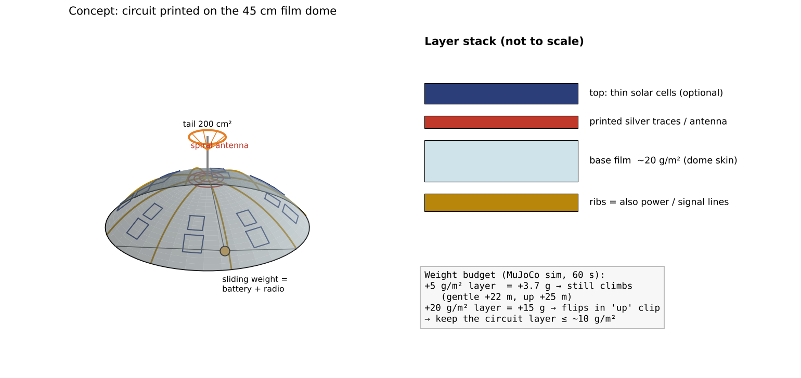
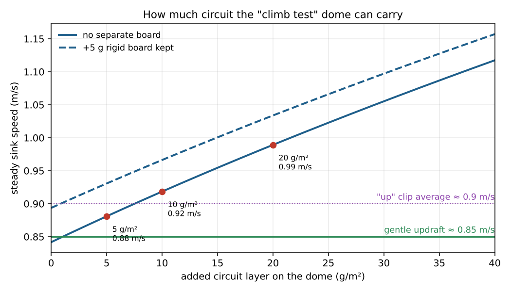
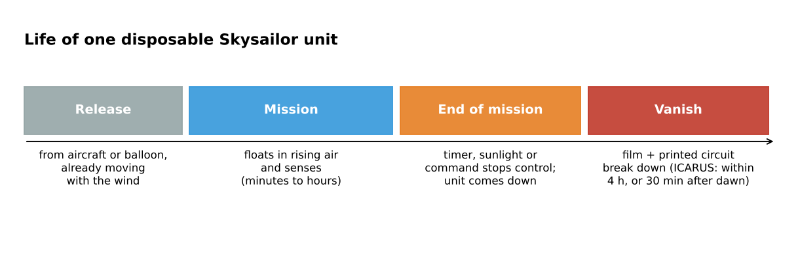
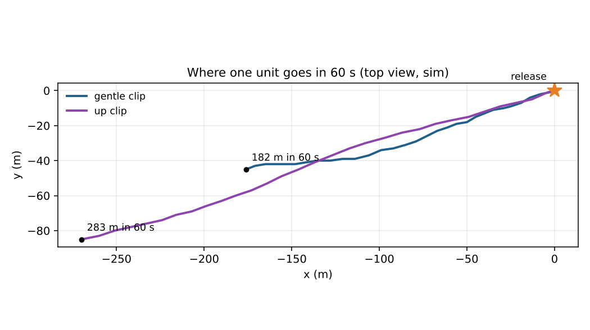

# Skysailor 다음 단계: soft circuit와 사라지는 비행체

이 문서는 지금까지의 결과(45 cm film dome + tail, `상승 시험` preset) 다음에 할 두 가지를 정리합니다. 그림 3장은 MuJoCo simulation 결과이고, 나머지 2장은 개념도와 계산값입니다.

## 큰 그림

지금까지는 "공중에 오래 떠 있는 모양"을 찾았습니다. 다음은 그 모양을 "수천 개 뿌려도 되는 장치"로 바꾸는 단계입니다.

- **Soft circuit**: dome film 자체를 회로 기판으로 씁니다. 따로 무거운 기판을 싣지 않으므로 무게가 거의 늘지 않습니다.
- **사라지는 비행체**: 임무가 끝나면 장치가 스스로 분해됩니다. 회수할 필요가 없고, 적이 주워서 분석할 수도 없습니다. DARPA ICARUS가 같은 방향의 사례입니다.

두 가지는 이어져 있습니다. 회로가 dome에 인쇄되어 있으면, dome이 분해될 때 회로도 함께 사라집니다.

---

## 1. Soft circuit: dome이 곧 회로 기판

### 무엇인가

배선, antenna, 필요하면 얇은 solar cell까지 dome film 위에 직접 인쇄하거나 붙입니다. 얇은 film 위에 은(silver) ink로 회로를 인쇄하는 방식이 일반적입니다.

- dome을 받치는 rib을 전원선과 신호선으로 함께 씁니다.
- dome 꼭대기 부분에 나선형 antenna를 둡니다. dome이 넓으므로 antenna도 크게 만들 수 있고, ops system에서 필요한 수동 RF 감지에 유리합니다.
- 자동 수평에 쓰는 움직이는 추(18 g)를 battery와 무선 장치로 만듭니다. 추가 하는 일이 둘이 되므로 쓸모없는 무게가 없습니다.

### 왜 무게가 핵심인가

하강 속도는 무게의 제곱근에 비례합니다. `상승 시험` dome은 약 0.84 m/s로 가라앉고, 약한 상승기류는 약 0.85 m/s입니다. 몇 g 차이로 올라가느냐 내려가느냐가 갈립니다.

위 도표는 계산값입니다(항력계수 1.47 × 0.95, 반지름 45 cm). 따로 단단한 기판(예: 5 g)을 그대로 싣고 가면 회로층이 없어도 이미 0.89 m/s가 됩니다.

### Simulation 결과: 회로층을 얼마나 실을 수 있나

`상승 시험` 설정에 회로층 무게를 dome 전체(0.75 m²)에 고르게 더해서 60초 동안 돌렸습니다. 실측 바람, 3 m에서 바람과 함께 놓기, 자동 수평 ON입니다.

| 더한 회로층 | 전체 무게 | gentle clip 60초 상승 | up clip 60초 상승 |
|---|---|---|---|
| 없음 | 39.3 g | +24.0 m | +27.1 m |
| +5 g/m² (+3.7 g) | 43.0 g | +22.4 m | +25.0 m |
| +10 g/m² (+7.5 g) | 46.8 g | +21.3 m | +23.2 m (최대 기울기 약 12°) |
| +20 g/m² (+15 g) | 54.3 g | +18.8 m | **약 25초에 뒤집힘**, 50초에 착지 |

- 10 g/m²까지는 계속 올라갑니다. 20 g/m²에서는 돌풍이 있는 up clip에서 뒤집힙니다.
- 따라서 회로층 목표는 **10 g/m² 이하**, 그리고 따로 싣는 단단한 기판은 없애는 것입니다.

### 다음에 할 일

1. 실제 인쇄 회로 film의 면적당 무게(g/m²)를 찾습니다.
2. dome이 접히거나 휘어질 때 인쇄된 선이 끊어지는지 확인합니다.
3. 회로층 때문에 film이 단단해지거나 공기가 새는 정도가 달라지는지 확인합니다. 달라지면 공기힘 표도 다시 봐야 합니다.

---

## 2. 사라지는 비행체 (DARPA ICARUS 사례)

### DARPA 사례

ICARUS(Inbound, Controlled, Air-Releasable, Unrecoverable Systems)는 2015년 10월에 발표된 DARPA program입니다. 26개월, 약 $8M 규모였습니다.

- 동력 없는 비행체를 항공기에서 떨어뜨려 최대 3 lb의 물자를 목표 지점 10 m 안에 내려놓습니다. 거리는 최대 150 km입니다.
- 내려놓은 뒤 **4시간 안에**, 밤에 떨어뜨린 경우 **아침 박명(civil twilight)이 시작된 뒤 30분 안에** 완전히 사라져야 합니다.
- 고체에서 바로 기체로 바뀌는 polymer를 썼습니다. 전자 부품은 자매 program VAPR에서 나왔고, 신호를 주면 고운 가루로 부서지는 유리 띠 같은 기술을 만들었습니다.
- 결과물의 예: Otherlab의 APSARA. 약 1 m 크기의 납작하게 접는 판지 glider로, 1 kg을 싣고 GPS, autopilot, 일회용 battery를 씁니다. 조립에 약 30분이 걸리고, C-17에서 수백 개를 떨어뜨리는 구상이었습니다. 다만 분해되는 것은 판지 몸체뿐이었고 전자 부품은 보통 부품이었습니다.

### Skysailor와의 관계

- **같은 계열입니다.** 싸고, 동력이 없고, 공중에서 떨어뜨리고, 한 번 쓰고 버립니다.
- **목표는 다릅니다.** ICARUS는 한 지점으로 날아가 물자를 내려놓습니다. Skysailor는 공중에 떠서 감지하는 장치이므로, 우리에게 "사라짐"은 임무가 끝난 뒤 남는 것을 없애는 문제입니다.
- **회수가 현실적으로 불가능합니다.** 아래 simulation에서 한 개가 60초 동안 182~283 m를 흘러갑니다. 몇 분, 몇 시간이면 km 단위로 흩어집니다.
- **군사용이므로** 땅에 떨어진 sensor를 적이 분석하지 못하게 해야 합니다.
- **대량 생산의 전제**입니다. 회수하지 않아도 되어야 수천 개를 뿌리는 의미가 있습니다.

### 어려운 점

- 분해되는 재료는 대개 약하거나 무겁습니다. 비행 내내 dome 모양을 유지해야 하고, 1번의 도표처럼 몇 g만 늘어도 상승이 줄어듭니다.
- 가장 어려운 부분은 전자 부품, 특히 battery입니다. APSARA도 이 부분은 풀지 못했습니다. 여기서 soft circuit이 도움이 됩니다. 분해되는 dome에 인쇄된 회로는 dome과 함께 사라집니다.
- 분해를 시작하는 방법을 정해야 합니다: timer, 햇빛, 또는 명령.

### 다음에 할 일

1. 목표 수명을 정합니다. 공중에서 얼마나 버텨야 하는지(몇 분~몇 시간), 그 뒤 얼마나 빨리 분해되어야 하는지.
2. 후보 재료를 정리합니다: 분해되는 plastic film, 기체로 바뀌는 polymer, 종이/판지. 각각의 면적당 무게와 강도를 지금 film(약 20 g/m²)과 비교합니다.

---

## 작업 순서

1. 지금의 dome + tail 설계를 먼저 굳힙니다. tail의 CFD 검증이 여전히 가장 큰 남은 문제입니다.
2. 실제 회로 film 자료로 1번의 무게 계산을 다시 합니다.
3. 사라지는 재료 후보의 자료를 모읍니다.
4. 둘을 합친 시제품 하나를 만듭니다: 분해되는 film dome 위에 인쇄한 회로.

## 한계

- Simulation의 공기힘은 240 mm cap의 예비 CFD 표를 45 cm로 키운 것입니다. tail은 dome 뒤쪽 흐름의 영향을 넣지 않은 단순 항력 model입니다.
- 회로층은 dome 전체에 고르게 더한 무게로만 넣었습니다. 강성이나 공기 투과 변화는 넣지 않았습니다.
- 각 경우는 한 번씩만 돌린 결과입니다.

## 출처

- ICARUS 발표: [Electronic Specifier, 2015](https://www.electronicspecifier.com/?p=47199), [Defense One, 2015](https://www.defenseone.com/technology/2015/10/military-wants-vampire-drones-die-sun/122722/)
- APSARA: [IEEE Spectrum](https://spectrum.ieee.org/otherlab-apsara-aerial-delivery-system)
- Simulation: 이 repository의 `hanging.py` DirectSim, `dashboard.py` 자동 수평 제어, `data/wind/measured.json` 실측 바람 (`상승 시험` 설정은 branch `tail-fabric-sim` 작업)
